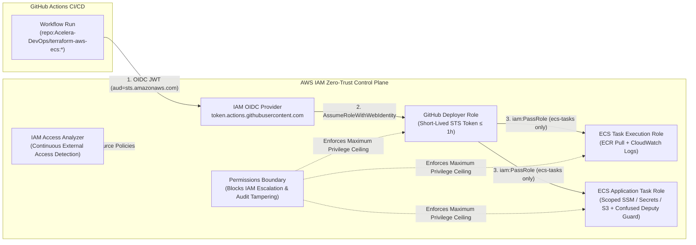

# Terraform AWS Zero-Trust IAM & PoLP Reference Architecture

[](https://www.terraform.io/)
[](https://registry.terraform.io/providers/hashicorp/aws/latest)
[](./oidc-github.tf)
[](./LICENSE)

Production-ready **Terraform AWS IAM Reference Architecture** implementing **Keyless GitHub Actions OIDC Federation**, strict separation of **ECS Execution vs. Application Task Roles**, **Permissions Boundaries** against privilege escalation, and continuous external access auditing via **AWS IAM Access Analyzer**.

---

## Architecture Overview



---

## Security Controls Matrix

| Control Domain | Implementation (`terraform-aws-iam`) | Threat Mitigated |
|----------------|--------------------------------------|------------------|
| **Keyless CI/CD Federation** | `aws_iam_openid_connect_provider` + `StringEquals` (`aud`) & `StringLike` (`sub`) conditions in [`oidc-github.tf`](./oidc-github.tf) | Eliminates long-lived `AWS_ACCESS_KEY_ID` / `AWS_SECRET_ACCESS_KEY` leakage in CI/CD |
| **Execution vs. Task Plane Split** | Separate `ecs_task_execution_role` and `ecs_application_task_role` in [`ecs-roles.tf`](./ecs-roles.tf) | Prevents application code RCE from accessing cluster-wide ECR or infrastructure privileges |
| **Cross-Service Confused Deputy Guard** | `aws:SourceAccount` and `aws:SourceArn` conditions on ECS Task Role trust policy | Prevents external or unauthorized ECS services from assuming the workload's Task Role |
| **Permissions Boundary Guardrails** | `aws_iam_policy.permissions_boundary` attached to all roles in [`permissions-boundary.tf`](./permissions-boundary.tf) | Blocks `iam:CreateUser`, `iam:CreateAccessKey`, boundary removal, and `cloudtrail:StopLogging` / `guardduty:DeleteDetector` |
| **Scoped `iam:PassRole`** | Restricted to exact ECS role ARNs + `iam:PassedToService = ecs-tasks.amazonaws.com` | Prevents CI/CD pipelines from passing administrative roles to arbitrary AWS services |
| **Continuous Policy Verification** | `aws_accessanalyzer_analyzer` (`ACCOUNT` scope) in [`access-analyzer.tf`](./access-analyzer.tf) | Automatically flags unintended external access to IAM roles, S3 buckets, or KMS keys |

---

## Quick Start

```hcl
module "iam_zero_trust" {
  source = "git::https://github.com/Acelera-DevOps/terraform-aws-iam.git?ref=main"

  project_name                = "acelera-platform"
  environment                 = "production"
  github_org                  = "Acelera-DevOps"
  github_repo                 = "terraform-aws-ecs"
  create_github_oidc_provider = true
  enable_access_analyzer      = true

  tags = {
    Environment = "production"
    ManagedBy   = "Terraform"
  }
}
```

### Using the OIDC Role in GitHub Actions

```yaml
permissions:
  id-token: write
  contents: read

steps:
  - name: Configure AWS Credentials (Keyless OIDC)
    uses: aws-actions/configure-aws-credentials@v4
    with:
      role-to-assume: arn:aws:iam::123456789012:role/acelera-platform-production-github-actions-deployer
      aws-region: us-east-1
```

---

## Inputs

| Name | Description | Type | Default | Required |
|------|-------------|------|---------|:--------:|
| `project_name` | Project or platform identifier prefix | `string` | n/a | yes |
| `environment` | Deployment environment (`dev`, `staging`, `production`) | `string` | `"production"` | no |
| `github_org` | GitHub organization allowed to assume OIDC role | `string` | `"Acelera-DevOps"` | no |
| `github_repo` | GitHub repository allowed to assume OIDC role | `string` | `"terraform-aws-ecs"` | no |
| `create_github_oidc_provider` | Create the GitHub OIDC provider resource | `bool` | `true` | no |
| `permissions_boundary_managed_policies` | Optional additional managed policy ARNs | `list(string)` | `[]` | no |
| `enable_access_analyzer` | Provision AWS IAM Access Analyzer | `bool` | `true` | no |
| `tags` | Common tags applied to all resources | `map(string)` | `{}` | no |

## Outputs

| Name | Description |
|------|-------------|
| `github_actions_role_arn` | ARN of the Keyless GitHub Actions OIDC Deployer IAM Role |
| `ecs_execution_role_arn` | ARN of the ECS Task Execution Role |
| `ecs_task_role_arn` | ARN of the PoLP ECS Application Task Role |
| `permissions_boundary_arn` | ARN of the IAM Permissions Boundary policy |
| `access_analyzer_arn` | ARN of the AWS IAM Access Analyzer |

---

## Author

**Erik Tonon** — Cloud & Platform Architect / SRE  
Website: [eriktonon.com](https://eriktonon.com)
